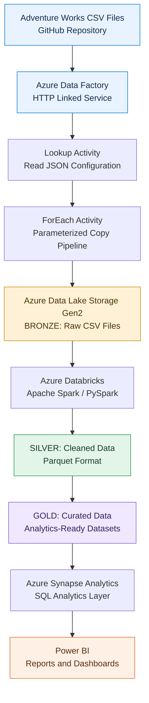

# 🚀 Adventure Works | End-to-End Azure Data Engineering Project

**Building a cloud-based data engineering pipeline using Azure Data Factory, Azure Data Lake Storage Gen2, Azure Databricks, Apache Spark, Azure Synapse Analytics, and Power BI.**

<p align="center">

  
  
  
  

</p>

---

## 📌 Table of Contents

- [Project Overview](#-project-overview)
- [Business Problem](#-business-problem)
- [Project Objectives](#-project-objectives)
- [Data Source](#-data-source)
- [Technology Stack](#-technology-stack)
- [Data Architecture](#-data-architecture)
- [End-to-End Workflow](#-end-to-end-workflow)
- [Medallion Architecture](#-medallion-architecture)
- [Data Ingestion with Azure Data Factory](#-data-ingestion-with-azure-data-factory)
- [Data Transformation with Databricks](#-data-transformation-with-databricks)
- [Analytics and Reporting](#-analytics-and-reporting)
- [Repository Structure](#-repository-structure)
- [Implementation Roadmap](#-implementation-roadmap)
- [Security and Cost Management](#-security-and-cost-management)
- [Key Learning Outcomes](#-key-learning-outcomes)
- [Author](#-author)

---

## 🎯 Project Overview

Adventure Works is an end-to-end data engineering project designed to demonstrate how business data can be ingested, stored, transformed, and prepared for analytics using Microsoft Azure services.

The solution uses CSV files containing information about customers, products, territories, sales, returns, and calendar dates. Azure Data Factory orchestrates data ingestion, Azure Data Lake Storage Gen2 organizes the data into processing layers, and Azure Databricks with Apache Spark performs data transformations.

The curated data is intended to be served through Azure Synapse Analytics and consumed through Power BI reports.

The project follows the **Medallion Architecture — Bronze, Silver, and Gold** — to separate raw data from cleaned and analytics-ready data.

**Project status:** In progress. This repository documents the solution design and implementation as the individual components are developed and validated.

## 💼 Business Problem

Business data is often distributed across multiple files and related entities. Before it can support reliable reporting, it needs to be ingested consistently, organized, validated, and transformed into a structure suitable for analysis.

This project addresses that challenge by designing a repeatable data pipeline that can:

- Ingest multiple source files without creating a separate pipeline for every file.
- Preserve raw data for traceability and reprocessing.
- Clean and transform source data using distributed processing.
- Organize related sales, customer, product, territory, and calendar information.
- Prepare curated datasets for analytical queries and business reporting.

## 🎯 Project Objectives

- Build an end-to-end cloud data engineering workflow.
- Implement parameterized and reusable ingestion pipelines.
- Apply Medallion Architecture using Bronze, Silver, and Gold layers.
- Use Apache Spark and PySpark for data transformation.
- Practice secure access between Azure services.
- Prepare structured data for analytical workloads.
- Integrate the data platform with Power BI for business intelligence.

## 📂 Data Source

The project uses the **Adventure Works dataset**, a sample business dataset commonly used for learning relational data modeling, sales analysis, and data engineering.

The source files cover business entities such as:

| Data entity | Purpose |
|---|---|
| Calendar | Date-based analysis |
| Customers | Customer attributes and segmentation |
| Products | Product-level information |
| Product Categories | Product classification |
| Product Subcategories | Detailed product classification |
| Territories | Geographic sales analysis |
| Sales | Sales transactions and performance |
| Returns | Product return analysis |

The sales data includes records associated with 2015, 2016, and 2017.

The actual CSV file names and source URLs will be documented alongside the ingestion configuration so that the project can be reproduced.

**Dataset source:** [Adventure Works sample databases — Microsoft Learn](https://learn.microsoft.com/en-us/sql/samples/adventureworks-install-configure)

> Note: The Microsoft sample database page provides Adventure Works database downloads and configuration guidance. The exact GitHub repository used for this project's CSV files should be linked separately once confirmed.

## 🛠️ Technology Stack

| Technology | Role in the project |
|---|---|
| Microsoft Azure | Cloud platform |
| Azure Data Factory | Ingestion and pipeline orchestration |
| Azure Data Lake Storage Gen2 | Raw, transformed, and curated data storage |
| Azure Databricks | Distributed data processing |
| Apache Spark / PySpark | Data reading, transformation, and writing |
| Microsoft Entra ID | Application identity and authentication |
| Azure Synapse Analytics | Analytical data serving and warehousing |
| Power BI | Business intelligence and visualization |
| Git and GitHub | Version control and project documentation |

## 🏗️ Data Architecture

The architecture below represents the intended end-to-end design. Components will be marked as implemented only after they have been tested successfully.



### Architecture at a glance

1. **Source:** CSV files hosted in GitHub.
2. **Ingestion:** Azure Data Factory retrieves source files over HTTP.
3. **Orchestration:** A JSON configuration and a ForEach activity drive reusable, parameterized copy operations.
4. **Bronze:** Original source files are stored in Azure Data Lake Storage Gen2.
5. **Silver:** Databricks and Spark clean and transform the raw data.
6. **Gold:** Curated datasets are prepared for business analytics.
7. **Serving:** Azure Synapse Analytics provides the intended SQL analytics layer.
8. **Visualization:** Power BI connects to the analytical data to produce business reports.

The Gold-layer implementation and downstream integrations will be documented as they are completed.

## 🔄 End-to-End Workflow

### Phase 1 — Azure Environment and Storage Setup

The foundation of the project consists of an Azure resource group, Azure Data Lake Storage Gen2, and the required service configurations.

Storage configuration used in the project:

- **Storage account:** `awstoragedatalake01`
- **Region:** West India
- **Performance:** Standard
- **Redundancy:** Locally redundant storage (LRS)
- **Hierarchical namespace:** Enabled
- **Data organization:** Bronze, Silver, Gold, and a configuration area for ingestion parameters

The hierarchical namespace supports directory-based organization within the data lake.

### Phase 2 — Data Ingestion with Azure Data Factory

The first ingestion step is to connect Azure Data Factory to the GitHub-hosted CSV files using an HTTP linked service.

The pipeline uses a Copy activity to transfer source data into the Bronze layer without applying business transformations.

#### Static pipeline

A static pipeline is used initially to validate connectivity, source configuration, the destination dataset, and the first successful file transfer.

#### Dynamic pipeline

The solution then moves towards a reusable, parameterized pipeline to avoid repeating the same Copy activity for every file.

The intended design includes:

- An HTTP linked service for the source.
- An Azure Data Lake Storage Gen2 linked service for the destination.
- Parameterized source and destination datasets.
- A JSON configuration containing the source path, destination folder, and file name for each iteration.
- A Lookup activity to read the JSON configuration.
- A ForEach activity to iterate through the configuration entries.
- A Copy activity inside the ForEach activity to transfer each file.
- Pipeline execution monitoring and validation of the files in Bronze.

This design makes it easier to add or manage files without duplicating the complete pipeline logic.

### Phase 3 — Bronze Layer: Raw Data Storage

The Bronze layer stores the ingested CSV files in their original form.

Its primary purpose is to preserve the source data before transformation.

Key principles:

- Retain the original source structure.
- Organize files into logical folders.
- Avoid applying business transformations during ingestion.
- Keep source data available for validation and reprocessing.

### Phase 4 — Silver Layer: Data Transformation

Azure Databricks and Apache Spark are used to read the Bronze CSV files, apply transformations, and write the processed datasets to Silver.

The transformation workflow covers:

- Reading CSV files with headers and schema inference where appropriate.
- Loading related business datasets into Spark DataFrames.
- Applying date transformations, including extracting month and year from calendar dates.
- Practicing PySpark column operations and built-in functions.
- Writing transformed data in Parquet format.
- Validating the output and organizing the transformed datasets.

Parquet is a column-oriented storage format suitable for analytical workloads.

Additional data-quality checks, type validation, null handling, and business rules can be documented as they are implemented.

### Phase 5 — Gold Layer: Curated Data

The Gold layer is intended to contain datasets prepared for business analysis.

Potential analytical models include:

- Sales performance by date, product, and territory.
- Customer-level sales analysis.
- Product category and subcategory performance.
- Product return analysis.
- Sales and return trends over time.

The final Gold tables, business rules, and schema will be documented after the transformations and data models are implemented and validated.

### Phase 6 — Azure Synapse Analytics

Azure Synapse Analytics is the planned serving layer for analytical data.

The implementation will document:

- The selected Synapse SQL architecture.
- Table creation and loading strategy.
- Relationships between fact and dimension tables.
- Analytical queries and validation.
- The connection used by reporting tools.

The final serving design will reflect the Synapse components actually deployed.

### Phase 7 — Power BI Reporting

Power BI is the intended reporting layer for business users.

Potential reporting areas include:

- Sales trends and performance.
- Customer and territory analysis.
- Product and category performance.
- Product returns and return trends.

Report screenshots, data model details, and dashboard findings will be added after the reports are built and validated.

## 🥉 Medallion Architecture

| Layer | Data state | Primary responsibility |
|---|---|---|
| Bronze | Raw | Preserve source data |
| Silver | Cleaned and transformed | Improve consistency and usability |
| Gold | Curated | Support analytical queries and reporting |

The separation of layers improves maintainability, traceability, and the ability to reprocess data when transformation rules change.

## 📁 Repository Structure

The repository will be organized as follows as implementation artifacts become available:

```text
adventure-works-azure-data-engineering/
│
├── README.md
├── .gitignore
│
├── docs/
│   ├── architecture-diagram.png
│   └── project-overview.md
│
├── adf/
│   ├── pipelines/
│   ├── datasets/
│   ├── linked-services/
│   └── parameters/
│
├── databricks/
│   └── notebooks/
│
├── synapse/
│   └── sql/
│
├── powerbi/
│   └── screenshots/
│
└── screenshots/
    ├── azure-storage/
    ├── adf-pipelines/
    └── databricks/
```

Only export and commit actual implementation artifacts. Do not commit secrets or sensitive connection details. Where configuration exports contain sensitive information, sanitize them before committing.

## 🗺️ Implementation Roadmap

The following checklist tracks the planned project milestones. Check off a task only after the corresponding implementation has been verified.

- [ ] Complete and validate the Azure environment setup.
- [ ] Configure Azure Data Lake Storage Gen2.
- [ ] Establish source and destination linked services in Azure Data Factory.
- [ ] Validate a static CSV ingestion pipeline.
- [ ] Implement JSON-driven, parameterized ingestion.
- [ ] Validate Lookup, ForEach, and Copy activity execution.
- [ ] Verify source files in the Bronze layer.
- [ ] Complete Databricks workspace and secure storage access configuration.
- [ ] Read Bronze datasets using Spark.
- [ ] Implement and validate Silver-layer transformations.
- [ ] Build and validate Gold-layer analytical datasets.
- [ ] Implement the Synapse analytical serving layer.
- [ ] Build and validate Power BI reports.
- [ ] Add architecture diagrams, screenshots, and technical documentation.
- [ ] Document data-quality checks and end-to-end validation results.

## 🔐 Security and Cost Management

Security and cost control are important considerations when building cloud data platforms.

- Use Microsoft Entra ID and appropriate access permissions where supported.
- Avoid hardcoding credentials, tokens, or client secrets in notebooks and pipeline exports.
- Keep local environment files and sensitive configuration out of Git.
- Follow least-privilege access principles.
- Monitor Azure resource usage and shut down or remove resources when they are no longer needed.
- Review pricing before deploying or running paid Azure services.

Azure trial credits and free-service allowances are subject to their applicable terms and limits. Always verify the current pricing and billing settings in your own subscription.

## 📚 Key Learning Outcomes

This project is designed to develop practical skills in:

- Cloud data ingestion and orchestration.
- Parameterized pipelines and configuration-driven processing.
- Data Lake Storage Gen2 and hierarchical data organization.
- Medallion Architecture.
- Apache Spark and PySpark transformations.
- Parquet-based analytical storage.
- Identity-based access and secure cloud configuration.
- SQL analytics and data warehouse integration.
- Power BI reporting and end-to-end data platform design.
- Git-based project documentation and version control.

## 👨‍💻 Author

**Satyam Kumar**

Data Analyst | Data Engineering | Azure Data Platform

This project is part of my hands-on learning journey in cloud data engineering and analytics.

---

⭐ If you find this project useful, feel free to explore the repository and share feedback.

**Note:** This project is a work in progress. Architecture diagrams describe the intended solution; implementation status and results will be updated as each stage is completed.
