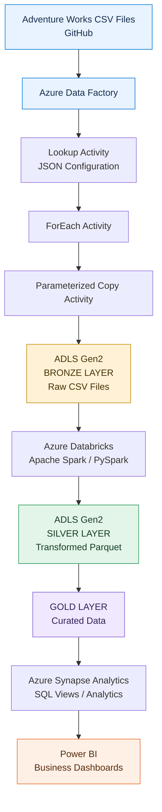

# 🚀 Adventure Works | End-to-End Azure Data Engineering Project

<p align="center">
  <strong>Building an end-to-end cloud data engineering solution using Microsoft Azure, PySpark, SQL and Power BI.</strong>
</p>

<p align="center">
  
  
  
  
  
  
</p>

<p align="center">
  
  
  
</p>

---

## 📌 Table of Contents

1. [Project Overview](#-project-overview)
2. [Business Objective](#-business-objective)
3. [Dataset](#-dataset)
4. [Technology Stack](#-technology-stack)
5. [Project Architecture](#-project-architecture)
6. [End-to-End Implementation](#-end-to-end-implementation)
7. [Medallion Architecture](#-medallion-architecture)
8. [Azure Data Factory](#-1-azure-data-factory--data-ingestion)
9. [Azure Data Lake Storage Gen2](#-2-azure-data-lake-storage-gen2)
10. [Azure Databricks](#-3-azure-databricks--data-transformation)
11. [Azure Synapse Analytics](#-4-azure-synapse-analytics--sql-serving)
12. [Power BI](#-5-power-bi--business-intelligence)
13. [Repository Structure](#-repository-structure)
14. [Project Screenshots](#-project-screenshots)
15. [Project Status](#-project-status)
16. [Security and Data Preservation](#-security-and-data-preservation)
17. [Key Learnings](#-key-learnings)
18. [Author](#-author)

---

## 🎯 Project Overview

The **Adventure Works Azure Data Engineering Project** demonstrates the development of an end-to-end cloud data engineering workflow using Microsoft Azure.

The project takes raw Adventure Works CSV datasets and processes them through multiple stages:

- Data ingestion using Azure Data Factory.
- Raw data storage using Azure Data Lake Storage Gen2.
- Data transformation using Azure Databricks and PySpark.
- Curated data preparation using the Medallion Architecture.
- SQL-based data access using Azure Synapse Analytics.
- Business intelligence and reporting using Power BI.

The solution follows the **Bronze, Silver and Gold Medallion Architecture** to organize data from its raw state into transformed and analytical layers.

## 💼 Business Objective

Organizations often receive data from multiple sources and in different formats. Before this data can support business decisions, it needs to be ingested, organized, transformed and made available for analytical reporting.

This project demonstrates how to build a reusable cloud data pipeline to:

- Automate ingestion of multiple CSV files.
- Maintain raw data for traceability.
- Transform and standardize datasets.
- Organize data into Bronze, Silver and Gold layers.
- Prepare analytical datasets for SQL querying.
- Support business reporting through Power BI.

## 📂 Dataset

**Dataset:** Adventure Works Sample Business Dataset

The project uses business datasets covering sales, customers, products, territories, returns and calendar information.

| Dataset | Business Purpose |
|---|---|
| Calendar | Date-based analysis |
| Customers | Customer information |
| Products | Product-level analysis |
| Product Categories | Product classification |
| Product Subcategories | Detailed product classification |
| Territories | Geographic sales analysis |
| Sales 2015 | Historical sales transactions |
| Sales 2016 | Historical sales transactions |
| Sales 2017 | Historical sales transactions |
| Returns | Product return analysis |

**Source:** [Microsoft AdventureWorks Sample Databases](https://learn.microsoft.com/en-us/sql/samples/adventureworks-install-configure)

The CSV source repository used for ingestion should be referenced separately when publishing the exact source URL.

---

## 🛠️ Technology Stack

| Technology | Purpose |
|---|---|
| Microsoft Azure | Cloud infrastructure |
| Azure Data Factory | Data ingestion and orchestration |
| Azure Data Lake Storage Gen2 | Cloud data lake storage |
| Azure Databricks | Distributed data processing |
| Apache Spark | Large-scale data processing |
| PySpark | Data transformation |
| Azure Synapse Analytics | SQL analytics and data serving |
| Power BI | Data visualization and reporting |
| Microsoft Entra ID | Authentication and identity |
| Git & GitHub | Version control and documentation |

---

## 🏗️ Project Architecture

The following diagram represents the overall data flow implemented and designed for this project.



### Architecture workflow

1. Source CSV files are hosted in GitHub.
2. Azure Data Factory connects to the source through an HTTP linked service.
3. A Lookup activity reads the JSON ingestion configuration.
4. A ForEach activity processes each configuration entry.
5. Copy activities dynamically load the files into the Bronze container.
6. Azure Databricks reads Bronze data and performs PySpark transformations.
7. Transformed datasets are stored in Silver in Parquet format.
8. Gold data and SQL views support analytical workloads.
9. Azure Synapse Analytics provides SQL-based access.
10. Power BI supports business intelligence and visualization.

---

## 🔄 End-to-End Implementation

## 🥉 1. Azure Data Factory – Data Ingestion

Azure Data Factory is used to ingest multiple Adventure Works CSV files from GitHub into Azure Data Lake Storage Gen2.

### Static ingestion pipeline

An initial pipeline named `GitToRaw` was created to validate source connectivity and destination configuration.

### Dynamic ingestion pipeline

A reusable pipeline named `dynamicGitToRaw` was implemented to automate multi-file ingestion.

**Pipeline components:**

- HTTP Linked Service – connects to GitHub source files.
- ADLS Gen2 Linked Service – connects to the destination data lake.
- Parameterized Source Dataset – dynamically receives source file information.
- Parameterized Sink Dataset – dynamically receives destination folder and file information.
- JSON Configuration – stores ingestion metadata.
- Lookup Activity – reads the configuration records.
- ForEach Activity – iterates through the configuration.
- Copy Data Activity – transfers the source files into Bronze.

### Dynamic pipeline flow

```text
JSON Configuration
       |
       v
Lookup Activity
       |
       v
ForEach Activity
       |
       v
Parameterized Copy Activity
       |
       v
Azure Data Lake Storage Gen2
       |
       v
Bronze Container
```

**Key implementation:** Instead of creating a separate Copy activity for every CSV file, the pipeline uses parameterization and configuration-driven execution.

---

## 🥉 2. Azure Data Lake Storage Gen2

Azure Data Lake Storage Gen2 is used as the centralized storage layer.

The project storage structure contains four containers:

| Container | Responsibility |
|---|---|
| bronze | Raw ingested CSV files |
| silver | Transformed Parquet datasets |
| gold | Curated analytical output |
| parameters | JSON configuration for dynamic ingestion |

### Bronze Layer

- Stores the original CSV source files.
- Maintains the raw data structure.
- Acts as the starting point for transformation.

### Silver Layer

- Stores processed datasets in Parquet format.
- Uses PySpark transformations.
- Organizes the transformed datasets into individual folders.

### Gold Layer

- Stores curated analytical output.
- Supports downstream SQL-based access.
- Includes the Gold external table/view workflow where implemented.

---

## 🥈 3. Azure Databricks – Data Transformation

Azure Databricks and PySpark are used to process data stored in the Bronze layer.

The exported Silver transformation notebook is available in:

`databricks/notebooks/SilverLayer.py`

### Data processing workflow

**1. Data Access**

- Configured OAuth-based access to ADLS Gen2.
- Used application identity for storage authentication.
- Read source datasets using ABFSS paths.

**2. Data Loading**

- Read CSV files with headers.
- Used schema inference.
- Loaded multiple datasets into Spark DataFrames.
- Used directory listing to identify source folders.

**3. Calendar Transformation**

- Extracted Month from Date.
- Extracted Year from Date.
- Prepared calendar data for analytical use.

**4. Customer Transformation**

- Combined Prefix, FirstName and LastName.
- Created a FullName column using PySpark functions.

**5. Product Transformation**

- Practiced string splitting and column transformations.
- Prepared product-related datasets.

**6. Sales Transformation**

- Read the 2015, 2016 and 2017 sales files using a wildcard path.
- Converted StockDate to timestamp.
- Replaced the sales order number prefix.
- Created a calculated multiplication column using OrderLineItem and OrderQuantity.

**7. Data Storage**

- Wrote transformed datasets to the Silver container.
- Used Parquet format.
- Organized the outputs into individual dataset folders.

---

## 🥇 4. Azure Synapse Analytics – SQL Serving

Azure Synapse Analytics is used for SQL-based access to the data lake.

SQL scripts were developed in Synapse Studio for schema creation and Gold-layer data access.

### SQL development artifacts

- Create Schema
- Create Gold View
- SQL Script 1

### Gold-layer SQL workflow

The project includes an external table workflow using Parquet data and SQL-based access.

Example of the external table creation pattern:

```sql
CREATE EXTERNAL TABLE gold.extcalender
WITH
(
    LOCATION = 'extcalender',
    DATA_SOURCE = source_gold,
    FILE_FORMAT = format_parquet
)
AS
SELECT *
FROM gold.calender;
```

The actual database objects, data source names and file formats should match the exported project SQL scripts.

---

## 📊 5. Power BI – Business Intelligence

Power BI is included as the reporting and visualization layer of the project.

The intended reporting areas include:

- Executive Sales Overview.
- Sales performance and trends.
- Product and category analysis.
- Customer analysis.
- Regional and territory performance.
- Return analysis.

Add the final `.pbix` report and actual dashboard screenshots to the repository when available.

---

## 🏛️ Medallion Architecture

| Layer | Description | Storage Format |
|---|---|---|
| Bronze | Raw source data | CSV |
| Silver | Cleaned and transformed data | Parquet |
| Gold | Curated analytical data | Parquet / SQL views |

The Medallion Architecture separates ingestion, transformation and analytical serving, making the data workflow easier to maintain and understand.

---

## 📁 Repository Structure

```text
adventure-works-azure-data-engineering/
│
├── README.md
│
├── adf/
│   ├── pipelines/
│   │   ├── GitToRaw.json
│   │   └── dynamicGitToRaw.json
│   │
│   ├── datasets/
│   │   ├── source-dataset.json
│   │   └── sink-dataset.json
│   │
│   ├── linked-services/
│   │   ├── Httplinkedservice.json
│   │   └── Storagedatalake.json
│   │
│   └── parameters/
│
├── databricks/
│   └── notebooks/
│       └── SilverLayer.py
│
├── data/
│   ├── bronze/
│   ├── silver/
│   └── gold/
│
├── synapse/
│   └── sql/
│       ├── create-schema.sql
│       ├── create-gold-view.sql
│       └── sql-script-1.sql
│
├── powerbi/
│   ├── reports/
│   └── screenshots/
│
└── docs/
    ├── architecture/
    │   └── project-architecture.png
    │
    └── screenshots/
        ├── adf/
        ├── adls/
        ├── databricks/
        ├── synapse/
        └── powerbi/
```

*The structure above is the recommended organization. Keep only files and folders that you actually add to GitHub.*

---

## 📸 Project Screenshots

Screenshots documenting the implementation will be maintained in the `docs/screenshots/` directory.

| Project Component | Screenshot Evidence |
|---|---|
| Azure | Resource group and service overview |
| Azure Data Factory | Dynamic pipeline and successful execution |
| ADF Configuration | Lookup, ForEach and Copy activity settings |
| ADLS Gen2 | Bronze, Silver and Gold containers |
| Databricks | Notebook and transformation outputs |
| Synapse | SQL scripts and query results |
| Power BI | Completed dashboard pages |

### Architecture Preview

Add your architecture image here:

`docs/architecture/project-architecture.png`

```markdown

```

### Azure Data Factory

```markdown

```

### Bronze, Silver and Gold

```markdown

```

### Databricks

```markdown

```

### Synapse Analytics

```markdown

```

### Power BI

```markdown

```

Replace these example image paths with the exact names of screenshots you upload.

---

## 📌 Project Status

The following table distinguishes the work implemented and artifacts captured from components that require further validation.

| Component | Status |
|---|---|
| Azure Data Lake Storage Gen2 | Implemented |
| ADF static ingestion pipeline | Implemented |
| ADF dynamic ingestion pipeline | Implemented |
| Parameterized datasets | Implemented |
| Lookup and ForEach activities | Implemented |
| Bronze data ingestion | Implemented |
| Databricks Silver transformation notebook | Exported |
| Silver Parquet datasets | Preserved |
| Gold data output | Preserved / SQL workflow documented |
| Synapse SQL scripts | Exported |
| Power BI final report | Verify final PBIX and dashboard artifacts |

---

## 🔐 Security and Data Preservation

As part of project archival, Azure implementation artifacts and data files were backed up locally for future reference.

Security practices:

- Removed exposed credentials from exported notebooks.
- Avoided committing client secrets and storage account keys.
- Sanitized linked-service JSON before public sharing.
- Avoided uploading passwords, SAS tokens and connection strings.
- Kept project configuration and code separate from sensitive credentials.

**Important:** Azure resource names, storage URLs and authentication settings should be reviewed before making the repository public. Any previously exposed client secret must be revoked or rotated.

Large data files may be kept in a separate backup instead of GitHub if they exceed repository limits or redistribution conditions.

---

## 🎓 Key Learning Outcomes

Through this project, I gained practical experience in:

- Building dynamic and reusable pipelines using Azure Data Factory.
- Implementing metadata-driven ingestion using Lookup and ForEach activities.
- Working with Azure Data Lake Storage Gen2.
- Applying Bronze, Silver and Gold Medallion Architecture.
- Reading and transforming datasets using Apache Spark and PySpark.
- Writing Parquet datasets to cloud storage.
- Developing SQL-based data access using Azure Synapse Analytics.
- Managing cloud project artifacts and configurations.
- Documenting and preserving an end-to-end cloud data engineering project.

---

## 👨‍💻 Author

**Shalini Singh**

Data Analyst | Azure Data Engineering | Data Analytics

Currently working as a Data Analyst and continuously developing practical skills in cloud data engineering, analytics and Microsoft Azure.

🔗 **LinkedIn:** [Connect with me](https://www.linkedin.com/in/shalinisingh-dataeng/)

---

⭐ If you find this project useful, feel free to explore the repository and share your feedback.

**Project:** Adventure Works – End-to-End Azure Data Engineering

**Focus:** Cloud Data Engineering | Data Ingestion | Data Transformation | SQL Analytics | Business Intelligence
