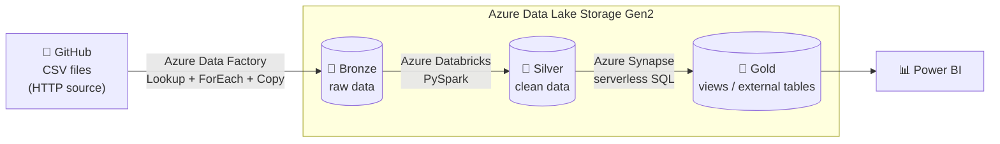
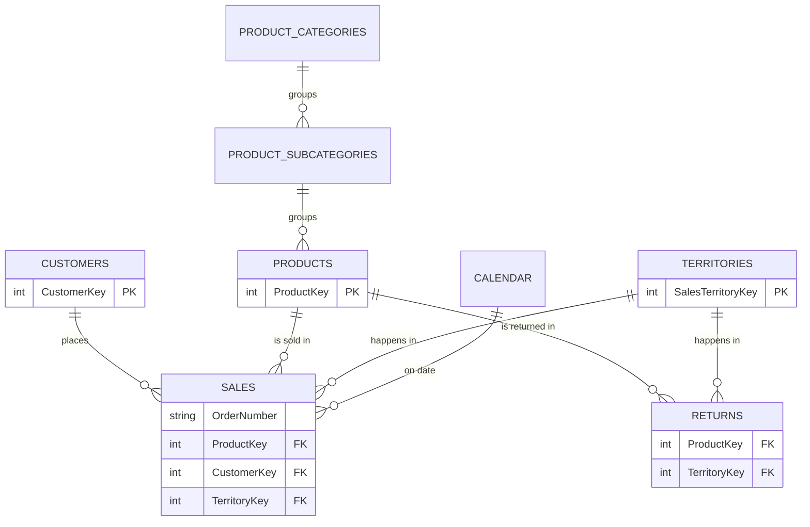
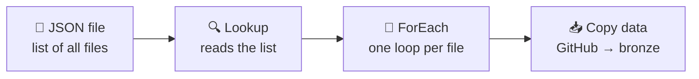

<div align="center">

# 🚴 AdventureWorks – End-to-End Azure Data Engineering Project

**Pull data from GitHub → clean it with Spark → serve it with SQL → ready for Power BI**


</div>

---

## 📌 Table of Contents

1. [What is this project?](#-what-is-this-project)
2. [Architecture](#-architecture)
3. [Tools used](#-tools-used)
4. [The dataset](#-the-dataset)
5. [Full flow, step by step (with screenshots)](#-full-flow-step-by-step)
6. [Problems I faced and how I fixed them](#-problems-i-faced-and-how-i-fixed-them)
7. [What I learned](#-what-i-learned)
8. [Project status](#-project-status)
9. [Repository structure](#-repository-structure)
10. [How to run it yourself](#-how-to-run-it-yourself)
11. [Security note](#-security-note)

---

## 🎯 What is this project?

Companies have data in many places. A data engineer's job is to **collect it, clean it, and make it easy to use** for analysts and managers.

In this project I built that whole journey on **Microsoft Azure**, using the popular **AdventureWorks** bike-company data:

| Question | Answer |
|---|---|
| Where does the data come from? | CSV files stored in a **GitHub** repo, pulled over an HTTP connection (like a real API) |
| How is it moved? | **Azure Data Factory** copies the files into a data lake |
| How is it cleaned? | **Azure Databricks** (PySpark) transforms the data |
| Where do analysts get it? | **Azure Synapse Analytics** serves it with SQL |
| How is it shown? | **Power BI** dashboards (next step) |

> [!TIP]
> **Why not just upload the CSV files by hand?**
> Because in real jobs, data usually comes from an API or another system, not from your laptop. Pulling it automatically is the skill that companies look for.

---

## 🏗 Architecture



### The Medallion Architecture in simple words

Think about **water**:

| Layer | Like water... | In my project |
|---|---|---|
| 🥉 **Bronze** | River water, straight from the source | Exact copy of the files from GitHub. **Nothing is changed.** |
| 🥈 **Silver** | Filtered, clean water | Data is cleaned and improved with Spark (new columns, fixed formats, joins, totals) |
| 🥇 **Gold** | Bottled water, ready to drink | Business-ready tables and views that analysts can use directly |

Why three layers? If something goes wrong in Silver or Gold, I can always go back to Bronze and start again, because the original data is still safe.

---

## 🧰 Tools used

| Tool | What it does here (easy words) |
|---|---|
| **GitHub** | Stores the source CSV files. This is where the data starts. |
| **Azure Data Factory (ADF)** | The "delivery truck". Moves data from GitHub into the data lake, automatically. |
| **Azure Data Lake Storage Gen2** | The "warehouse". Has three containers: `bronze`, `silver`, `gold`. |
| **Azure Databricks** | The "factory". Uses Spark (Python) to clean and transform big data fast. |
| **Microsoft Entra ID (App Registration)** | The "ID card" that lets Databricks safely enter the data lake. |
| **Azure Synapse Analytics** | The "shop window". Lets analysts query the final data with simple SQL. |
| **Managed Identity** | The "ID card" that lets Synapse safely enter the data lake (no passwords needed). |
| **Power BI** | Charts and dashboards (planned next step). |

---

## 📦 The dataset

**AdventureWorks** is a famous sample dataset from Microsoft. It is about a company that sells **bikes, components, clothing and accessories**.

I picked it because it has **many related tables**, just like real company data. That means lots of practice with joins and lookups.

📁 The files are in the [`data/`](data/) folder. Full column descriptions are in the [data dictionary](data/README.md).

| File | Rows | What it contains |
|---|---:|---|
| `AdventureWorks_Calendar.csv` | 912 | One row per day (1 Jan 2015 → 30 Jun 2017) |
| `AdventureWorks_Customers.csv` | 18,148 | Customer details (name, income, education, job...) |
| `AdventureWorks_Products.csv` | 293 | Product details (name, color, cost, price...) |
| `AdventureWorks_Product_Categories.csv` | 4 | Bikes, Components, Clothing, Accessories |
| `AdventureWorks_Product_Subcategories.csv` | 37 | Groups inside each category (e.g. Mountain Bikes) |
| `AdventureWorks_Territories.csv` | 10 | Sales regions and countries |
| `AdventureWorks_Sales_2015.csv` | 2,630 | 🧾 **Fact table**: sales of 2015 |
| `AdventureWorks_Sales_2016.csv` | 23,935 | 🧾 **Fact table**: sales of 2016 |
| `AdventureWorks_Sales_2017.csv` | 29,481 | 🧾 **Fact table**: sales of 2017 (until 30 Jun) |
| `AdventureWorks_Returns.csv` | 1,809 | 🧾 **Fact table**: products that customers returned |

**In total: 56,046 sales rows** (25,164 unique orders) across 3 years.

> **Fact vs Dimension (quick explanation)**
> - **Fact tables** = events that happen again and again (a sale, a return). They are big.
> - **Dimension tables** = descriptions of things (who is the customer? what is the product?). They are small.

### How the tables connect



---

## 🚀 Full flow, step by step

### Step 1️⃣ – Create the Azure resources

Everything lives inside one **Resource Group** (think of it as a folder that holds all the project's Azure services). It contains:

- a **Storage Account** with hierarchical namespace turned on (this makes it a *Data Lake Gen2*),
- an **Azure Data Factory**,
- an **Azure Databricks** workspace,
- later, an **Azure Synapse** workspace.

<p align="center"></p>
<p align="center"><em>Creating the storage account inside the <code>Adventure_Works_Project</code> resource group.</em></p>

<p align="center"></p>
<p align="center"><em>The resource group with Databricks, Data Factory and the Data Lake storage account.</em></p>

Inside the data lake, I create three containers: **`bronze`**, **`silver`**, and **`gold`**.

---

### Step 2️⃣ – Bronze layer: pull data from GitHub with Azure Data Factory

**Goal:** copy all CSV files from GitHub into the `bronze` container, without changing anything.

**The easy but bad way:** make 10 Copy activities, one for each file. ❌ Boring, and hard to maintain.

**The smart way (what I built):** make **one dynamic pipeline** that works for every file. ✅



How it works:

1. **Lookup** reads a small JSON file. It is a list, one item per CSV file.
2. **ForEach** goes through the list one item at a time.
3. Inside the loop, a single **Copy data** activity runs. It uses **parameters** for the three things that change each time: *which file to take from GitHub, which folder to save into, and the file name*.

So one Copy activity does the job of ten. If a new file is added, I only add one line to the JSON list. No pipeline change is needed.

<p align="center"></p>
<p align="center"><em><code>dynamicGitToRaw</code> pipeline: Lookup → ForEach → Copy data. All the copy runs succeeded ✅</em></p>

📂 Related ADF objects: pipelines `GitToRaw` and `dynamicGitToRaw`, and datasets `ds_http` (source), `ds_raw` (sink), plus the parameterized `ds_git_dynamic`, `ds_git_parameters` and `ds_sink_dynamic`.

---

### Step 3️⃣ – Silver layer: clean the data with Azure Databricks

**Goal:** read the raw files from `bronze`, clean and improve them with PySpark, and save the result in `silver`.

<p align="center"></p>
<p align="center"><em>The Databricks workspace is ready.</em></p>

#### 3.1 Give Databricks permission to open the data lake

Databricks cannot just walk into the storage account. It needs an **ID card**. I created an **App Registration** in Microsoft Entra ID, and used its *client id*, *client secret* and *tenant id* to log in with OAuth.

<p align="center"></p>
<p align="center"><em>Notebook section "DATA ACCESS USING APP". (Secrets are hidden in this screenshot.)</em></p>

```python
storage_account = "adventureworkdatalake1"

spark.conf.set(f"fs.azure.account.auth.type.{storage_account}.dfs.core.windows.net", "OAuth")
spark.conf.set(f"fs.azure.account.oauth.provider.type.{storage_account}.dfs.core.windows.net",
               "org.apache.hadoop.fs.azurebfs.oauth2.ClientCredsTokenProvider")
spark.conf.set(f"fs.azure.account.oauth2.client.id.{storage_account}.dfs.core.windows.net",
               "<application-client-id>")
spark.conf.set(f"fs.azure.account.oauth2.client.secret.{storage_account}.dfs.core.windows.net",
               dbutils.secrets.get(scope="<scope-name>", key="<secret-key>"))   # never hard-code the secret!
spark.conf.set(f"fs.azure.account.oauth2.client.endpoint.{storage_account}.dfs.core.windows.net",
               "https://login.microsoftonline.com/<directory-tenant-id>/oauth2/token")
```

> [!IMPORTANT]
> In real projects the secret is stored in a **secret scope / Key Vault**, not typed inside the notebook.

#### 3.2 Read the data

The URL format for the data lake is easy to forget (and often asked in interviews):

```
abfss://<container>@<storage-account-name>.dfs.core.windows.net/<folder>
```

<p align="center"></p>
<p align="center"><em>Reading the Calendar CSV from the <code>bronze</code> container into a Spark DataFrame.</em></p>

Instead of writing one `spark.read` for each file, I used a **loop** that loads every dataset into a Python dictionary:

```python
dataframes = {}

for folder_path in folders:          # folders = list of bronze folder paths
    folder_name = folder_path.rstrip("/").split("/")[-1]
    try:
        df = (
            spark.read
                 .format("csv")
                 .option("header", "true")
                 .option("inferSchema", "true")
                 .load(folder_path)
        )
        dataframes[folder_name] = df
        print(f"Loaded: {folder_name}")
    except Exception as e:
        print(f"Could not load {folder_name}: {e}")

print(f"\nSuccessfully loaded {len(dataframes)} datasets.")
```

<p align="center"></p>
<p align="center"><em>The loop loads all the AdventureWorks datasets in one go.</em></p>

#### 3.3 Transform the data

Examples of transformations:

```python
from pyspark.sql.functions import col, concat, lit, month

# Customers: build a full name column
customers = dataframes["AdventureWorks_Customers"].withColumn(
    "fullname", concat(col("FirstName"), lit(" "), col("LastName"))
)

# Calendar: add a month column
calendar = dataframes["AdventureWorks_Calendar"].withColumn("Month", month(col("Date")))
```

<p align="center"></p>
<p align="center"><em>New <code>fullname</code> column on the Customers table.</em></p>

I also used **`groupBy`** to turn thousands of transaction rows into **aggregated numbers** (for example, total orders per day), because reports need totals, not single transactions.

<p align="center"></p>
<p align="center"><em>Databricks visualization: total orders by order date. Orders grow strongly from mid-2016.</em></p>

The last step of this layer is to write the cleaned data to the **`silver`** container (see [Project status](#-project-status)).

---

### Step 4️⃣ – Gold layer: serve the data with Azure Synapse Analytics

**Goal:** let analysts read the data with plain SQL, without touching Spark or the data lake directly.

I created a **Synapse workspace** (`synapse-adventure-works`). It uses a *Managed Identity*, which works like an ID card that the workspace already has, so no password is needed to read the lake.

<p align="center"></p>
<p align="center"><em>Synapse workspace: basics (resource group, name, region, default data lake).</em></p>

<p align="center"></p>
<p align="center"><em>Synapse workspace: SQL admin login and security settings.</em></p>

<p align="center"></p>
<p align="center"><em>Synapse Studio is ready 🎉</em></p>

To create **external tables** (tables that only point to the files, the data stays in the lake), Synapse needs three things:

| # | Object | In simple words |
|---|---|---|
| 1 | **Database scoped credential** | "Which ID card should I use?" (Managed Identity) |
| 2 | **External data source** | "Where are the files?" (`silver` and `gold` containers) |
| 3 | **External file format** | "What type of files are they?" (Parquet, Snappy-compressed) |

The full script is here: 👉 [`sql/synapse_setup.sql`](sql/synapse_setup.sql)

```sql
CREATE DATABASE SCOPED CREDENTIAL cred_adventureworks
WITH IDENTITY = 'Managed Identity';

CREATE EXTERNAL DATA SOURCE source_silver
WITH (
    LOCATION   = 'https://adventureworkdatalake1.dfs.core.windows.net/silver',
    CREDENTIAL = cred_adventureworks
);

CREATE EXTERNAL FILE FORMAT format_parquet
WITH (
    FORMAT_TYPE      = PARQUET,
    DATA_COMPRESSION = 'org.apache.hadoop.io.compress.SnappyCodec'
);
```

> [!NOTE]
> For this to work, the Synapse workspace's managed identity must have the **Storage Blob Data Contributor** role on the storage account (Access control (IAM) → Add role assignment).

---

### Step 5️⃣ – Power BI (next step)

Connect Power BI to the Synapse serverless SQL endpoint, load the gold views (facts + dimensions), and build the dashboard. This is the last piece that lets a data engineer help an analyst end to end.

---

## 🛠 Problems I faced and how I fixed them

Real projects never go perfectly. These problems taught me more than the happy path, and they are good interview stories. 💪

<details>
<summary><b>❌ Problem 1: Azure Databricks workspace deployment failed</b></summary>

<br>

My first Databricks workspace failed with *"The resource write operation failed to complete successfully, because it reached terminal provisioning state 'Failed'"*.

What I did:

1. Read the error and the **Activity log** to find which operation failed.
2. Checked the **managed resource group** that Databricks created (it already had storage, NAT gateway, etc.).
3. Tried to open **Cloud Shell** to investigate, but it said the subscription is not registered for the `Microsoft.CloudShell` namespace.
4. Opened the failed workspace, saw it was stuck in a **failed state**, then **deleted** it.
5. **Created a new workspace** (`adventure_works_databricks02`) and the validation passed ✅.

<p align="center"></p>
<p align="center"><em>First attempt: creating the workspace.</em></p>

<p align="center"></p>
<p align="center"><em>The deployment failed.</em></p>

<p align="center"></p>
<p align="center"><em>Checking the managed resource group.</em></p>

<p align="center"></p>
<p align="center"><em>Managed storage account created by Databricks.</em></p>

<p align="center"></p>
<p align="center"><em>Activity log: "Create Databricks Workspace" failed.</em></p>

<p align="center"></p>
<p align="center"><em>Activity log: "Create Deployment" failed.</em></p>

<p align="center"></p>
<p align="center"><em>Opening Cloud Shell to investigate.</em></p>

<p align="center"></p>
<p align="center"><em>Cloud Shell needs the namespace to be registered first.</em></p>

<p align="center"></p>
<p align="center"><em>The workspace is stuck in a failed state.</em></p>

<p align="center"></p>
<p align="center"><em>Deleting the failed workspace.</em></p>

<p align="center"></p>
<p align="center"><em>Creating it again: validation succeeded ✅</em></p>

**Lesson:** a failed deployment leaves a broken resource behind. Read the activity log, delete the failed resource, and create it again.

</details>

<details>
<summary><b>❌ Problem 2: <code>NameError: name 'dataframes' is not defined</code></b></summary>

<br>

I ran the cell that uses `dataframes["AdventureWorks_Calendar"]` **before** the cell that creates the `dataframes` dictionary.

**Fix:** run the notebook cells in the right order (or use **Run all**).

<p align="center"></p>

</details>

<details>
<summary><b>❌ Problem 3: <code>UNRESOLVED_COLUMN</code> – column <code>Date</code> not found</b></summary>

<br>

Spark said it could not find `Date`, and suggested `Country`, `Region`, `Continent`, `SalesTerritoryKey`. Those are the columns of the **Territories** table. So the variable `df` was holding a different table than I expected (it had most likely been overwritten while looping over the files).

**Fix:** stop relying on a shared `df` variable. Use the dictionary instead, so every table has a clear name: `dataframes["AdventureWorks_Calendar"]`.

<p align="center"></p>

</details>

<details>
<summary><b>❌ Problem 4: <code>AZURE_INVALID_CREDENTIALS_CONFIGURATION</code></b></summary>

<br>

Spark could not open the storage account. The error mentioned the account name **`adventureworkdatalake01`**, but the OAuth settings were written for **`adventureworkdatalake1`**. Most likely a small typo: Spark was asked to open an account that had no matching credentials.

**Fix:** use exactly the same storage account name everywhere. Now I keep it in one variable (`storage_account`) so it can't be mistyped twice.

<p align="center"></p>

</details>

---

## 🧠 What I learned

- ✅ How to design a **Medallion (Bronze → Silver → Gold)** pipeline.
- ✅ Building **dynamic** ADF pipelines with **parameters, Lookup and ForEach**, not 10 copy-pasted activities.
- ✅ Pulling data **directly from an HTTP / GitHub source** instead of uploading files by hand.
- ✅ Securely connecting services: **App Registration (OAuth)** for Databricks and **Managed Identity** for Synapse.
- ✅ The **`abfss://`** URL format for Azure Data Lake Gen2.
- ✅ Reading many files with a **loop** in PySpark and transforming them (`withColumn`, `concat`, `groupBy`).
- ✅ Creating **external tables** in Synapse: *credential → data source → file format*.
- ✅ **Debugging real Azure and Spark errors** instead of only following a tutorial.

---

## ✅ Project status

- [x] Azure resource group, storage account (ADLS Gen2), Data Factory
- [x] Bronze layer: dynamic ADF pipeline (Lookup + ForEach + Copy) from GitHub
- [x] Databricks workspace created (after fixing the failed deployment)
- [x] Silver layer: connect to the lake, load all datasets, first transformations
- [x] Synapse workspace created
- [x] Synapse setup script (credential, data sources, file format)
- [ ] Silver layer: finish all transformations and write to `silver`
- [ ] Gold layer: create external tables / views in Synapse
- [ ] Power BI dashboard

---

## 📁 Repository structure

```
adventure-works-azure-data-engineering/
│
├── README.md                      ← you are here
├── .gitignore                     ← keeps secrets out of Git
│
├── data/                          ← the 10 source CSV files
│   ├── README.md                  ← data dictionary (every column explained)
│   └── AdventureWorks_*.csv
│
├── sql/
│   └── synapse_setup.sql          ← credential, data sources, file format
│
├── notebooks/                     ← Databricks notebook(s) (SilverLayer)
├── adf/                           ← exported Data Factory pipeline JSON
├── config/
│   └── credentials.example.txt    ← template only, NO real secrets
│
└── images/                        ← all screenshots used in this README
```

---

## ▶️ How to run it yourself

1. **Create an Azure free account** (you get free credits to learn).
2. **Create the resources:** resource group → storage account (turn on *hierarchical namespace*) → containers `bronze`, `silver`, `gold` → Data Factory → Databricks → Synapse.
3. **Upload the CSV files from [`data/`](data/) to your own GitHub repo**, so ADF can pull them using the raw file URL.
4. **In ADF:** create an HTTP linked service (GitHub raw URL) and a Data Lake linked service, build the Lookup → ForEach → Copy pipeline, and run it. Check that the files land in `bronze`.
5. **In Entra ID:** create an *App Registration* and a client secret. In the storage account, give the app the **Storage Blob Data Contributor** role.
6. **In Databricks:** connect to the lake (Step 3.1), read the bronze data, transform it, and write it to `silver`.
7. **In Synapse:** give the workspace's managed identity the **Storage Blob Data Contributor** role, then run [`sql/synapse_setup.sql`](sql/synapse_setup.sql) and create your external tables or views.
8. **Connect Power BI** to Synapse and build your report.

---

## 🔒 Security note

This repo does **not** contain any passwords, client secrets or keys. A template is provided in [`config/credentials.example.txt`](config/credentials.example.txt). Real values must stay out of Git (see `.gitignore`).

If you ever commit a secret by mistake, **rotate it immediately**. Deleting it from the latest commit is not enough, because it stays in the Git history.

---

## 🙌 Credits

- **AdventureWorks** sample data by Microsoft.
- Project built while learning from a public end-to-end Azure Data Engineering tutorial, then extended with my own debugging and notes.

---

<div align="center">

### 👩‍💻 Built by [Shalini Singh](https://github.com/Shalini-Singh11)

⭐ If this project helped you, please give it a star!

</div>
